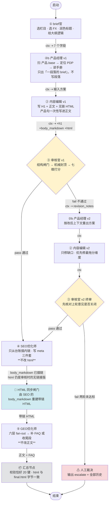

# Divoom 内容流水线｜架构与数据传递

本文档回答两个问题：**每个 Agent 收到需求后具体做什么**、**数据怎么在它们之间传**。

**画布模板**：`tpl-fb8d4ff6ebd7`（`Divoom 五角色内容流水线`，mode1）
**落盘位置**：`~/.dsh/visual-workflow/flow-templates/tpl-fb8d4ff6ebd7.json`
**规模**：**14 个节点 / 27 条线** = **15 条流程线**（谁接谁）+ **12 条数据线**（字段怎么流）

---

## 一、全景流程图



**节点角色分三类**（看颜色）：

| 类型 | 节点 | 说明 |
| --- | --- | --- |
| **内容角色**（有 skill） | ① brief官、② 内容编辑 v1/v2、③ 审核官 v1/v2、④ SEO优化师、⑤ GEO优化师 | 读 `skills/<角色>/SKILL.md`，按角色边界作业 |
| **编排器节点**（无 skill，确定性） | 🔗 HTML 同步闸门、📦 汇总节点 | 跑脚本 + 校验，不创作。跑挂了就终止，不许手工绕过 |
| **出口节点** | ⚠ 人工裁决 | 两轮未达标时停下来等人，不静默放行 |

---

## 二、两种线，别混淆

| | **流程线**（15 条，`flow-out → flow-in`） | **数据线**（12 条，`ctx-out → ctx-in`） |
| --- | --- | --- |
| 管什么 | **执行顺序**：下一个该谁跑 | **字段传递**：上一个的产出怎么进下一个 |
| 带条件吗 | 带。`pass` / `fail` 决定走哪条分支 | 不带条件，无条件传 |
| 断了会怎样 | 流程走不到那个节点 | 下游拿不到上游字段，只能读文件 |
| 举例 | `③ 审核官 v1 --fail--> ② 内容编辑 v2` | `③ 审核官 v1 ⇢ ④ SEO优化师` |

> 为什么分成两套：审核节点有**两条出口**（通过 / 打回），但**两条出口都要把字段往下传**。如果只有流程线，「打回」分支就会丢掉字段。所以每条流程线旁边都配一条同端点的数据线（`n_review1 → n_edit2` 与 `n_review1 → n_seo` 各有一条 ctx 线）。

---

## 三、逐节点契约（收到什么 → 做什么 → 交出什么）

### ① brief官 · `n_brief`

| | |
| --- | --- |
| **收到** | 用户的一句主题（编排器直接注入，无上游字段） |
| **读文件 / 工具** | `skills/brief官/SKILL.md`<br/>`流程契约.md`<br/>`实体库/实体变量库.csv` + `实体库/变量组-*.md`（14 组）<br/>`<选定栏目>/标题与大纲规范.md`（取 FX 主表）<br/>**`~/.local/bin/fsearch`**（外部 SERP 实测，见第九节） |
| **做什么** | 1. 从主题抽槽位：对象 / 条件 / 现象 / 结果<br/>2. 查 `实体库/` 确认这些概念在 Divoom 语境里**真的成立**<br/>3. **跑 `~/.local/bin/fsearch` 实测 2–4 个查询**（见第九节），记录 position/url/title/description、域名分布、divoom.com 占位位次；派生查询与读缺口<br/>4. 润色标题，**必须保留原主题限定词**（`after` / `even when` / `without` / `vs` / `for [role]`）<br/>5. 按路由规则定栏目（见第六节）<br/>6. 从该栏目 FX 主表选 **一个** 最匹配的 FX<br/>7. 按该 FX 的 H2 箭头逻辑给大纲逻辑链路<br/>8. 给参考 URL 清单（必须真实可访问、非本地化语言前缀） |
| **交出** | `work/runs/<runId>/00-brief.json`<br/>字段：`topic` `column` `fx` `polished_title` `search_demand` `outline_logic` `reference_urls` |
| **传给** | ctx ⇢ ② 内容编辑 v1 |
| **边界** | 不写正文、不选锚文本、不写 meta |

### ② 内容编辑 v1 · `n_edit1`

| | |
| --- | --- |
| **收到** | ① 的 7 个字段（ctx），其中 `polished_title` / `fx` / `outline_logic` 是写作依据 |
| **读文件** | `skills/内容编辑/SKILL.md`<br/>`<栏目>/标题与大纲规范.md`（FX 的 H1 公式与 H2 箭头）<br/>`<栏目>/正文写作规范.md`（**六节全读**）<br/>`<栏目>/锚文本规范.md`<br/>`<栏目>/实例/`（只借结构，不借事实） |
| **做什么** | 1. 按 FX 的 H1 公式写 H1<br/>2. 按 H2 箭头逻辑排 H2，**不写 H3**<br/>3. 按「正文写作规范」六节写正文：开头两段 → 每个 H2 的推进 → 证据与产品提及 → 结尾给边界<br/>4. 每个 Divoom 事实回 `实体库/` 查证<br/>5. 正文 1200–2200 英文词<br/>6. 产出**无链接**的 `html`（H1 + 正文，不带 `<html>`/`<head>`） |
| **交出** | `work/runs/<runId>/01-draft-v1.json`<br/>新增字段：`h1` `body_markdown` `html`（**brief 的 7 个字段原样继承**） |
| **传给** | ctx ⇢ ③ 审核官 v1 |
| **边界** | **此轮不产出** `title` / `meta_description` / `summary` / `slug` / 内链 / 外链 / `faq`；写了也会被后续角色覆盖 |

### ③ 审核官 v1 · `n_review1`

| | |
| --- | --- |
| **收到** | ② 的全部字段（含 `body_markdown`、`h1`、`fx`） |
| **读文件** | `skills/审核官/SKILL.md`<br/>`skills/审核官/references/audit-dimensions.md`<br/>`<栏目>/实例汇总.md`（建立质量基线） |
| **做什么** | 1. **结构闸门**（不通过就终止，不往下评分）：栏目与 FX 匹配 / H1 限定词在开头与各节兑现 / H2 按箭头推进且无 H3 / 1200–2200 词 / 开头两段直接回应 H1 / Markdown 与 HTML 同序 / **此轮不得有内链、meta、FAQ**<br/>2. **跑机械封顶层**：`python3 skills/审核官/scripts/hard_limits.py <稿件.md> --json`，把降级理由**原样并入 `cons`**，标签 `[系统强制降级]`。**封顶后的分数才是最终分**<br/>3. **七维打分**（每维 0–10，各给稿件位置与一句依据）：`experience` `expertise` `authoritativeness` `trustworthiness` `hcu` `infogain` `ymyl`<br/>4. 算 `aggregate_eeat` = 前四个 E-E-A-T 的均值<br/>5. **`fact_grounding` 逐条列证**：`原句 → 实体库文件与条目 → 支持/不支持/超出适用层级`<br/>6. 写 `revision_notes`：位置 + 缺口 + 验收结果，**不代写正文**<br/>7. 定 verdict |
| **放行条件** | 四条**同时**成立才 `pass`：结构闸门通过 + **零硬伤** + `aggregate_eeat` ≥ 8.0 + **七维最低分 ≥ 7.0**（七维等权） |
| **交出** | `work/runs/<runId>/02-review-v1.json`<br/>新增：`scores` `verdict` `revision_notes` `fact_grounding`<br/>`verdict ∈ pass / revise / escalate` |
| **传给** | **pass** → ctx ⇢ ④ SEO优化师<br/>**fail** → ctx ⇢ ② 内容编辑 v2（带 `revision_notes`） |
| **边界** | **不改稿**。产出是「编辑能照着改的意见」 |

### ② 内容编辑 v2 · `n_edit2`

| | |
| --- | --- |
| **收到** | ③ 的审核稿（含 `revision_notes`、`scores`） |
| **读文件** | `skills/内容编辑/SKILL.md` + ③ 的 `revision_notes` + 栏目三份规范 |
| **做什么** | 1. **先核对上一轮意见是否关闭**<br/>2. 只修本轮缺口，**优先修审核点名的最拖分维度**<br/>3. 复核相邻段逻辑<br/>4. 覆盖 `h1` `body_markdown` `html` |
| **交出** | `work/runs/<runId>/01-draft-v2.json`<br/>继承全部字段，保留旧 `review` 作为前轮记录 |
| **传给** | ctx ⇢ ③ 审核官 v2 |
| **边界** | **不生成 v3**（全流程最多两轮）；不覆盖 `01-draft-v1.json` |

### ③ 审核官 v2 终审 · `n_review2`

| | |
| --- | --- |
| **收到** | ② v2 的全部字段 |
| **做什么** | 同 v1，但**先核对第一轮 `revision_notes` 是否关闭**，再评新稿；重跑 `hard_limits.py` |
| **交出** | `work/runs/<runId>/02-review-v2.json` |
| **传给** | **pass** → ctx ⇢ ④ SEO优化师<br/>**fail** → ctx ⇢ ⚠ 人工裁决 |

### ⚠ 人工裁决 · `n_escalate`

| | |
| --- | --- |
| **收到** | ③ v2 的审核稿 |
| **做什么** | 1. 输出 `verdict: escalate` 与**全部历史**（`01-draft-v1/v2`、`02-review-v1/v2`）<br/>2. 列出两轮都没关闭的缺口<br/>3. 列出被点名过的最拖分维度<br/>4. 明确写「需人工裁决」 |
| **严禁** | 静默放行 / 自行降低阈值 / 生成第三版稿件 |
| **传给** | → 结束（**人接手**，不再进 SEO） |

### ④ SEO优化师 · `n_seo`

| | |
| --- | --- |
| **收到** | ③ 通过的稿件（`body_markdown` 是**无链接**的） |
| **读文件** | `skills/SEO优化师/SKILL.md`<br/>`锚文本总规范.md`（16 类锚文本 + 词数标准：中位 4 词，主用 3–6 词）<br/>`<栏目>/锚文本规范.md`（本栏目类型子集 + 选链规则）<br/>`发布与链接记录/已发布文章.md`（**256 篇官方 URL，内链唯一合法来源**）<br/>`发布与链接记录/待补内链.md`（没合适目标时的登记处） |
| **做什么** | 1. 从台账里找真实内链目标 → 在 `body_markdown` 里**就地插入链接**<br/>2. 写 `title`（50–60 字符）/ `meta_description`（140–160 字符）/ `summary`（60–90 词）<br/>3. 生成 `slug`（从 H1 转小写连字符）<br/>4. 找真实外链填 `external_links`<br/>5. 找不到合适内链目标的，登记 `pending_links` + 写入 `待补内链.md` |
| **交出** | `work/runs/<runId>/03-seo.json`<br/>新增：`title` `meta_description` `summary` `slug` `internal_links` `external_links` `pending_links`，以及**插入链接后的** `body_markdown` |
| **传给** | ctx ⇢ 🔗 HTML 同步闸门 |
| **边界** | **不编辑 `html`**（`03-seo.json` 的 `html` 仍是审核时的无链接版）<br/>不改正文观点/H2/段落结构<br/>**正文绝不留空链接或占位符**<br/>`pending_links` 里的条目**不得**出现在正文中 |

### 🔗 HTML 同步闸门 · `n_htmlsync`

| | |
| --- | --- |
| **收到** | `03-seo.json`（关键是**已插链的** `body_markdown`） |
| **做什么** | `python3 tools/html_sync.py <body.md> -o <out.html>`，把结果写回该 JSON 的 `html` 字段 |
| **校验**（不通过就报错退出） | ① 可见文字与 Markdown 一致<br/>② `<h1>` 数 = `# ` 数<br/>③ `<h2>` 数 = `## ` 数<br/>④ `<a>` 数 = `](` 数 |
| **为什么必须在这一步** | SEO 只改 `body_markdown`、不改 `html`。若不重建，**GEO 会拿到无链接的旧 HTML** 并在后面追加 FAQ，最终 `final.html` 就没有内链 |
| **严禁** | 手写 HTML 绕过闸门；改动 `body_markdown` 的可见文字与标题 |
| **传给** | ctx ⇢ ⑤ GEO优化师 |

### ⑤ GEO优化师 · `n_geo`

| | |
| --- | --- |
| **收到** | 🔗 闸门产出的**带链 HTML** |
| **读文件** | `skills/GEO优化师/SKILL.md`<br/>`<栏目>/实例汇总.md`（学 FAQ 深度与问法）<br/>`<栏目>/标题与大纲规范.md`（确认 H1 承诺） |
| **做什么** | 1. 按**六层**拆 query fan-out 子问题：`定义 / 条件 / 对比 / 操作 / 边界 / 成本`<br/>2. 逐条判定 `covered` / `gap_filled` / `out_of_scope`<br/>3. **有缺口 → 写 `faq`；无缺口 → 写 `closing_paragraph`**（两者互斥）<br/>4. FAQ 每条 40–90 词、第一句直接答、可独立读懂<br/>5. 在**带链 HTML 尾部**追加 FAQ 或收尾段 |
| **交出** | `work/runs/<runId>/04-geo.json`<br/>新增：`faq` `closing_paragraph` `fanout` `eeat_notes`，以及追加后的 `html` |
| **传给** | ctx ⇢ 📦 汇总节点 |
| **边界** | **不改正文一个字**；没有真实缺口时**宁可给收尾段，不要硬造问题** |

### 📦 汇总节点 · `n_summary`

| | |
| --- | --- |
| **收到** | ⑤ 的全部字段 |
| **做什么** | 1. 合并全部字段，校验最终 JSON **恰好 20 键**，不增不减<br/>2. 写 ISO 8601 到 `generated_at`<br/>3. `url` 留空字符串<br/>4. 输出 `final.json` 与 `final.html`<br/>5. **校验 JSON 里的 `html` 与 `final.html` 字节一致**（校验和比对）<br/>6. 校验 `internal_links` 与 `body_markdown` 里实际链接一一对应 |
| **交出** | `work/runs/<runId>/final.json` + `final.html` |
| **任何一条校验不过** | 报错终止，**不放行** |

---

## 四、数据传递的三种方式

| 方式 | 载体 | 用途 | 可追溯性 |
| --- | --- | --- | --- |
| **① ctx 数据线** | 画布内存 | 节点间**字段传递**的正式通道（10 条） | 运行中可见 |
| **② JSON 落盘** | `work/runs/<runId>/*.json` | 每轮快照，**不覆盖历史** | ✅ 全量可回溯 |
| **③ 共享知识库（只读）** | `实体库/`、`<栏目>/*规范.md`、`实例/`、两张台账 | Agent 自己按路径去读的**参考资料**，不经 ctx 传 | ✅ 版本化在库里 |

**字段只增不减**：后一角色只补自己拥有的字段，不得清空前序字段。这就是为什么 20 键最终 JSON 能一路拼出来。

### 一次运行的文件时间线

```text
work/runs/<runId>/
├── 00-brief.json       ① 写     7 字段
├── 01-draft-v1.json    ② 写     +h1 +body_markdown +html
├── 02-review-v1.json   ③ 写     +scores +verdict +revision_notes +fact_grounding
├── 01-draft-v2.json    ② 写     ← 仅被打回时才有；继承上轮全部字段
├── 02-review-v2.json   ③ 写     ← 仅被打回时才有
├── 03-seo.json         ④ 写     +title +meta_description +summary +slug
│                                +internal_links +external_links +pending_links
│                                +body_markdown（已插链）
├── 04-geo.json         ⑤ 写     +faq +closing_paragraph +fanout +eeat_notes +html
├── final.json          汇总     恰好 20 键
└── final.html          汇总     与 final.json 的 html 字节一致
```

`<runId>` 用启动时间，例如 `2026-09-29T09-40-12`。

---

## 五、回环与分支规则

| 规则 | 值 | 在哪定义 |
| --- | --- | --- |
| 最大重写轮数 | **2** | `流程契约.md` §五 + 审核官/内容编辑 skill |
| 谁决定打回 | ③ 审核官（**不改稿**） | 审核官 skill |
| 打回后谁改 | ② 内容编辑（只修缺口） | 内容编辑 skill |
| 放行条件 | 结构闸门 + 零硬伤 + `aggregate_eeat` ≥ 8.0 + 七维最低 ≥ 7.0 | 审核官 skill §三.7 |
| 两轮仍未达标 | `escalate` → ⚠ 人工裁决 → 结束 | 审核官 skill |
| 版本文件 | `v1`、`v2` 两版，**不覆盖历史**，不产出 `v3` | `流程契约.md` §三 |

> **画布为什么没有回边**：visual-workflow 的流程图层禁止环。所以「回环」被建模成**前向条件分支 + 第二版节点**——「两轮」在拓扑上就是 `②编辑v1 / ③审核v1` + `②编辑v2 / ③审核v2` 两组节点，而不是一个圈。这是画布的硬限制，不是设计选择。

---

## 六、栏目路由规则（① brief官 用来定栏目）

| 用户想要什么 | 栏目 | FX 前缀 |
| --- | --- | --- |
| **理解**现象背后的机制与边界 | `科技与信息` | `F1–F14` |
| **修好**故障并确认修好 | `帮助与提示` | `S1–S12` |
| 在同一任务、同一比较轴上**选出赢家** | `产品对比` | `PC1–PC10` |
| 判断**要不要买、按什么标准选、淘汰谁** | `购买指南` | `BG1–BG11` |
| **做完并观察到成功状态** | `设置与使用` | `SU1–SU13` |

> `设置与使用` 用 `SU` 前缀，不是 `F`（两个 F 命名空间会撞车）。

---

## 七、硬约束在哪个节点被强制

| 硬约束 | 谁强制 | 违反后果 |
| --- | --- | --- |
| **搜索需求必须外部实测**（`fsearch`），不得用 `实体库/` 顶替 | ① brief官 | 取不到结果才 `BLOCKED_SEARCH_DEMAND` 阻断 |
| **不得写搜索量**（`fsearch` 不返回） | ① brief官 | `search_demand.volume` 必须为 `null` |
| 内链只指向 `已发布文章.md` 里真实可访问的 Divoom URL | ④ SEO + 📦 汇总 | 没有目标就登记 `pending_links`，**正文不留空链接** |
| Divoom 事实只能来自 `实体库/` | ② 编辑 + ③ 审核（`fact_grounding` 逐条列证） | 查不到 = 硬伤，**不得 pass** |
| **型号名必须与官方命名一致**（`品牌资料库/产品/`） | ③ 审核（`hard_limits.py` 型号名规则） | 自创/拼错的型号名 = **硬伤**，直接 fail<br/>官方名库缺失时压 8.0 并告警 |
| 竞品事实 / 医疗建议 / 竞品链接不得进稿 | ② 编辑 + ③ 审核 | 同上 |
| 字段只增不减；回环不覆盖历史 | 各节点自检 + 📦 汇总 | 汇总校验失败 |
| 审核官不改稿；GEO 不改正文 | ③ 与 ⑤ 的 skill 边界 | 角色越界，产出被下游覆盖 |
| HTML 必须由 SEO 的 `body_markdown` 重建 | 🔗 闸门（四项校验） | **报错终止**，不许手写绕过 |
| `final.json` 恰好 20 键；`html` 与 `final.html` 字节一致 | 📦 汇总 | 报错终止，不放行 |
| 安全话题先给边界说明 | ③ 审核（`hard_limits.py` 安全规则） | 涉电气/安装/防水/儿童且无边界 → 封顶 **5.5** |
| 营销词 / 内链密度 / 无源数值 | ③ 审核（`hard_limits.py`） | 封顶 7.5 / 7.5 / 7.0 |

---

## 八、最终 JSON 的 20 键归属

| # | 字段 | 产出节点 | 说明 |
| --- | --- | --- | --- |
| 1 | `topic` | ① | 用户原始主题 |
| 2 | `column` | ① | 栏目中文名 |
| 3 | `fx` | ① | FX 编号 |
| 4 | `h1` | ② | 正文 H1 |
| 5 | `title` | ④ | meta title，50–60 字符 |
| 6 | `meta_description` | ④ | 140–160 字符 |
| 7 | `summary` | ④ | 60–90 词 |
| 8 | `slug` | ④ | 从 H1 生成 |
| 9 | `url` | — | **留空**，发布时由人回填 |
| 10 | `body_markdown` | ② 产出，④ 仅插链 | SEO 后的完整正文 |
| 11 | `html` | ② 出正文，🔗 重建，⑤ 追加 FAQ | 只给片段，不含 `<html>`/`<head>` |
| 12 | `faq` | ⑤ | `[{question, answer}]`，与 `closing_paragraph` 互斥 |
| 13 | `closing_paragraph` | ⑤ | 无 FAQ 时的收尾段 |
| 14 | `internal_links` | ④ | `[{anchor, url, h2, type}]`，须与正文链接一一对应 |
| 15 | `external_links` | ④ | `[{anchor, url, why}]` |
| 16 | `pending_links` | ④ | `[{anchor_candidate, topic, h2, reason}]`，**不得出现在正文** |
| 17 | `fanout` | ⑤ | `[{layer, question, verdict, evidence}]` |
| 18 | `eeat_notes` | ⑤ | 字符串数组，观察而非改写 |
| 19 | `review` | ③ | `{scores, verdict, rounds, revision_notes}` |
| 20 | `generated_at` | 📦 | ISO 时间戳 |

> ① 另有 `polished_title` `search_demand` `outline_logic` `reference_urls` 四个字段，只写进 `00-brief.json`，**不进最终 JSON**。

---

## 九、外部需求确认：轻量，1–2 次搜索

**① brief官 的重心在内部——栏目路由 + 该栏目 FX 主表的 H1 公式。** 外部联网只用来做一次确认。

```bash
~/.local/bin/fsearch "<核心头词>" --limit 10          # 外面有没有人在写/在问
~/.local/bin/fsearch "<核心头词>" --ugc --limit 10    # Reddit / Medium / Quora 上真实用户的原话
```

| | |
| --- | --- |
| 工具 | `~/.local/bin/fsearch`（Firecrawl `POST /v2/search`），凭据 `~/.opencli/firecrawl.env` |
| `--ugc` | 只看 `reddit.com,medium.com,quora.com,stackexchange.com,superuser.com` 的用户发言 |
| 只回答 | ① 外面有没有真实的人在问？② 他们的**原话**是什么（抄 1–3 句进 `user_voice`） |
| **不搜整条标题** | 竞品实测：标题是编辑式长尾（中位 **12 词**、49% 问句、仅 9% 带品牌名）。拿整条标题搜，返回的是泛化头词内容——**需求在头词上，标题只是围着它写的承诺** |
| **不做** | 多查询堆量 / SERP 位次统计 / 竞品缺口分析 |
| **不写搜索量** | `fsearch` 不返回搜索量，`search_demand.volume` 强制 `null` |
| 成本 | 约 1–2 credits/次；余额 81,489（2026-09-29 快照） |

**实测支撑**（109 篇竞品语料）：拿精确 H1 当查询，文章自己排第 1，但后面 9 条全是泛化头词内容——
搜「粉末喷涂金属餐椅耐久性」的精确标题，出来的是粉末喷涂**工业公司**页面；搜「活性炭与泡棉密封圈如何工作」的精确标题，出来的是 NYT Wirecutter 的「最佳尿布桶」。
所以外部只需要确认**头词**有人问，标题结构由内部 FX 公式负责。

### 关于 `实体库/` 的定位（澄清）

`实体库/` **不是外部知识源，而是「本站现有信息 + 实体关系」的台账**——记录站点目前有哪些实体（品类、部件、能力、场景、参数……）及它们之间的关系。它回答「**这个话题在 Divoom 语境里站得住吗、能指代什么**」，不是「这个产品的客观真相是什么」。

| | 回答什么 | 谁用 |
| --- | --- | --- |
| `fsearch`（外部） | 外面有没有人在问、真实用户怎么说 | ① brief官 轻量确认 |
| `实体库/`（内部台账） | 本站现在有什么可写、实体之间什么关系 | ①② 把断言落到可支撑的实体上 |

> 待补：`实体库/` 目前只有 `变量组 / 实体组` 两列，**没有 URL 维度**。要做到「看到辅助 URL 与实体的关系脉络」，需要补 URL↔实体 映射（与第十节第 3 条「产品页/集合页导入」是同一件事）。

## 十、已知的残留与限制

1. **正文语料仍有少量商品卡/目录行**（`Add to Cart` 类已清）。按「一轮清洗噪音就好」的要求停在此处；要再收一轮，改 `fetch_fc.py` 的规则后跑 `python3 fetch_fc.py --reclean` 即可——**原始输出已缓存在 `work/raw_fc/`，不用联网**。
2. **五个栏目的 `正文写作规范.md` 基线尚未逐篇人工核对**。状态字段已标注「基线已对 `work/bodies/` 全部 109 篇复算核对」，但那是**统计层面**的核对，不是逐篇精读。
3. **产品页 / 集合页尚未导入**。后续导入后，正文出现品类词时可挂锚文本内链到集合页；本轮不做。
4. **配图师、产品经理两个角色尚未定义**。
