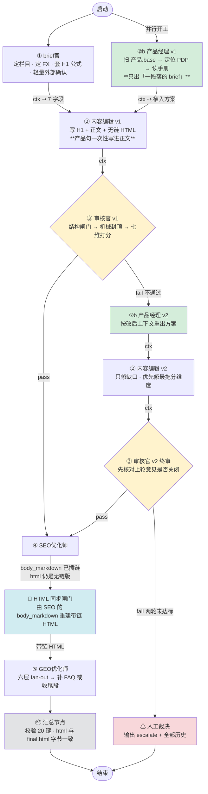

# Divoom 五角色内容流水线｜画布快照

> 这是画布的可读快照。**权威内容在画布本身**（GUI → visual workflow → 模板 `Divoom 五角色内容流水线`）；
> 本文件是导出视图，改了画布要重新导出，别只改这里。

**模式**：`mode1` —— 节点**不会自动跑**，由父代理用 `wf_run_node` 逐个启动。它是「编排 DAG + 可视化契约」，不是自动驾驶。
**规模**：14 节点 / 28 线 = **16 条流程线**（谁接谁）+ **12 条数据线**（字段怎么流）。
**首轮并行**：`启动` 同时开 `①brief官` 与 `②b产品经理v1`，两者汇入 `②内容编辑v1`。

---

## 一、流程图



**颜色**：🟩 产品经理（新增）｜🟨 审核分支｜🟦 编排器闸门｜⬜ 汇总｜🟥 人工出口

---

## 二、每个 Agent 的工作职责

### ① brief官 · `n_brief`

**职责**：把用户一句主题变成可执行的 brief。**重心在内部——栏目路由 + 该栏目 FX 主表的 H1 公式**；外部只做一次轻量确认。

| | |
| --- | --- |
| **调用** | `~/.local/bin/fsearch`（1–2 次：主查询 + `--ugc` 看 Reddit/Medium/Quora 真实用户原话） |
| **查看** | `skills/brief官/SKILL.md`、`流程契约.md`、`实体库/实体变量库.csv`、`<栏目>/标题与大纲规范.md`（FX 主表） |
| **输入** | 用户主题（一句话） |
| **输出** | `00-brief.json`（仅 7 键）：topic, column, fx, polished_title, search_demand, outline_logic, reference_urls |
| **边界** | 不写正文、不选锚文本、不写 meta；**搜核心头词不搜整条标题**；`volume` 强制 `null` |
| **交给** | ②b 产品经理 v1 |

---

### ②b 产品经理 v1 · `n_pm1`　🟩 新增

**职责**：判断这篇文章**要不要**提产品、提哪个、锚文本怎么写、插在哪个 H2。**只出一段落的 brief，不写段落原文。**

| | |
| --- | --- |
| **调用** | 无外部脚本（确定性检索） |
| **查看** | `产品植入规范.md`★、`品牌资料库/README.md`、`品牌资料库/产品.base`、`品牌资料库/产品/<handle>.md`、`品牌资料库/手册/<key>.md`、`实体库/` |
| **输入** | ① brief 的 topic/column/fx/outline_logic（**此时还没有正文**） |
| **输出** | `01b-product-v1.json`（**不进最终 20 键**）：植入(bool), 产品键, PDP_URL, 锚文本+词数, 路径(A集合/B商品), 建议 H2, 匹配依据, 这段要讲哪几点 |
| **边界** | 一篇 ≤1 产品、≤1 处提及；**禁产品级 H2**；禁开头两段；**不植入也是合法结果**（竞品 25% 不提产品） |
| **交给** | ② 内容编辑 v1 |

**四条硬判据（全过才植入）**：① 有上下文（该 H2 确实在讲这个）② 有能力对应（手册里找得到）③ 有实体支撑（`实体库/` 找得到）④ 删掉仍成立。

---

### ② 内容编辑 v1 · `n_edit1`

**职责**：按 brief + 产品经理方案写出第一轮正文。**产品句一次性写进正文，不后补。**

| | |
| --- | --- |
| **调用** | 无外部脚本 |
| **查看** | `skills/内容编辑/SKILL.md`、`产品植入规范.md`（第四节）、`<栏目>/标题与大纲规范.md`、`<栏目>/正文写作规范.md`（**六节全读**）、`<栏目>/实例/` |
| **输入** | brief 的 7 个字段 + **②b 的植入方案** |
| **输出** | `01-draft-v1.json`：新增 h1, body_markdown, html（无链接版） |
| **边界** | 不写 H3；**此轮不写内链/meta/FAQ**；1200–2200 词；植入时锚文本按方案、段内自然嵌入 |
| **交给** | ③ 审核官 v1 |

---

### ③ 审核官 v1 · `n_review1`

**职责**：独立查证、评分、定位缺口。**决定 pass / revise / escalate。不改稿。**

| | |
| --- | --- |
| **调用** | `python3 skills/审核官/scripts/hard_limits.py <稿件.md> --json`（机械封顶层） |
| **查看** | `skills/审核官/SKILL.md`、`references/audit-dimensions.md`、`<栏目>/实例汇总.md`、`实体库/`、`品牌资料库/产品/`（核对型号名） |
| **输入** | ② 内容编辑 v1 的全部字段（已含产品句） |
| **输出** | `02-review-v1.json`：scores（七维）、aggregate_eeat、verdict、revision_notes、fact_grounding |
| **放行** | 结构闸门 + **零硬伤** + `aggregate_eeat` ≥ 8.0 + 七维最低分 ≥ 7.0，四条同时成立 |
| **分支** | `pass → ④ SEO`｜`fail → ②b 产品经理 v2` |
| **边界** | 不代写正文；`revision_notes` 只写「位置 + 缺口 + 验收结果」 |

---

### ②b 产品经理 v2（打回后）· `n_pm2`　🟩 新增

**职责**：编辑要按审核意见改稿了，**先按审核意见重出植入方案**（改稿会让上下文变，旧方案可能失准）。仍然只出方案。

| | |
| --- | --- |
| **调用** | 无外部脚本 |
| **查看** | `产品植入规范.md`★、`品牌资料库/产品.base`、`品牌资料库/产品/<handle>.md` |
| **输入** | ③ 审核 v1 的 revision_notes + 上一轮 `01b-product-v1.json` |
| **输出** | `01b-product-v2.json`：同 v1，另记 `supersedes: v1` |
| **边界** | **撤掉方案、改成不植入，都是合法输出**；不为凑数而植入 |
| **交给** | ② 内容编辑 v2 |

---

### ② 内容编辑 v2（打回后）· `n_edit2`

**职责**：第二轮，也是最后一轮修订。

| | |
| --- | --- |
| **调用** | 无外部脚本 |
| **查看** | `skills/内容编辑/SKILL.md`、审核官 revision_notes、栏目三规范、`产品植入规范.md` |
| **输入** | ③ 审核 v1 的 revision_notes + **②b 产品经理 v2 的方案** |
| **输出** | `01-draft-v2.json`：更新 h1, body_markdown, html；保留旧 review 作为前轮记录 |
| **边界** | 先核对上轮意见是否关闭；优先修最拖分维度；**不生成 v3、不覆盖 v1** |
| **交给** | ③ 审核官 v2 |

---

### ③ 审核官 v2（终审）· `n_review2`

**职责**：终审。先核对第一轮 `revision_notes` 是否关闭，再评新稿。

| | |
| --- | --- |
| **调用** | `hard_limits.py --json`（重跑） |
| **查看** | 同 v1，另核对上轮意见关闭情况 |
| **输入** | ② 内容编辑 v2 的全部字段 |
| **输出** | `02-review-v2.json` |
| **分支** | `pass → ④ SEO`｜`fail → ⚠ 人工裁决` |
| **边界** | 全流程**最多两轮**，不产出第三版 |

---

### ⚠ 人工裁决（两轮未达标）· `n_escalate`

**职责**：两轮未达标时**停下来并如实汇报**。

| | |
| --- | --- |
| **调用** | 无 |
| **查看** | 全部历史 `01-draft-v1/v2`、`02-review-v1/v2`、`01b-product-v1/v2` |
| **输出** | `verdict: escalate` + 全部历史；列出两轮都没关闭的缺口与曾被点名的最拖分维度 |
| **边界** | **严禁**静默放行 / 自行降阈值 / 生成第三版 |
| **交给** | 结束（人接手） |

---

### ④ SEO优化师 · `n_seo`

**职责**：在过审正文上补齐 SEO 字段，**就地插入内链**。

| | |
| --- | --- |
| **调用** | 无外部脚本 |
| **查看** | `skills/SEO优化师/SKILL.md`、`锚文本总规范.md`、`<栏目>/锚文本规范.md`、`发布与链接记录/已发布文章.md`（**256 篇，内链唯一来源**）、`待补内链.md`、`品牌资料库/`（产品锚文本） |
| **输入** | ③ 过审稿件 |
| **输出** | `03-seo.json`：title, meta_description, summary, slug, internal_links, external_links, pending_links，以及**仅插链的** body_markdown |
| **边界** | **不改 `html`**；正文绝不留空链或占位符；`pending_links` 不得出现在正文 |
| **交给** | 🔗 HTML 同步闸门 |

---

### 🔗 HTML 同步闸门 · `n_htmlsync`

**职责**：由 SEO 的 `body_markdown` **确定性重建带链 HTML**。编排器步骤，不创作。

| | |
| --- | --- |
| **调用** | `python3 tools/html_sync.py <body.md> -o <out.html>` |
| **查看** | `03-seo.json` 的 body_markdown（已插链） |
| **输出** | 写回该 JSON 的 `html` 字段 |
| **校验** | 可见文字 / H1 数 / H2 数 / 链接数 —— 任一不符即**报错退出** |
| **边界** | **严禁手写 HTML 绕过闸门** |
| **交给** | ⑤ GEO优化师 |

> 为什么必须在 SEO 之后：SEO 只改 `body_markdown`、不改 `html`。不重建的话 GEO 会拿到无链旧 HTML，最终 `final.html` 就没有内链。

---

### ⑤ GEO优化师 · `n_geo`

**职责**：按 query fan-out 判断内容缺口，补 FAQ 或收尾段。

| | |
| --- | --- |
| **调用** | 无外部脚本 |
| **查看** | `skills/GEO优化师/SKILL.md`、`<栏目>/实例汇总.md`（学 FAQ 深度）、`<栏目>/标题与大纲规范.md` |
| **输入** | 🔗 闸门产出的**带链 HTML** |
| **输出** | `04-geo.json`：faq, closing_paragraph, fanout, eeat_notes，以及尾部追加后的 html |
| **边界** | `faq` 与 `closing_paragraph` **互斥**；每条 40–90 词；**不改正文一个字** |
| **交给** | 📦 汇总节点 |

---

### 📦 汇总节点 · `n_summary`

**职责**：合并全部字段并校验，产出最终交付物。

| | |
| --- | --- |
| **调用** | 无外部脚本（纯校验） |
| **查看** | ⑤ 的全部字段 |
| **输出** | `final.json` + `final.html` |
| **校验** | 恰好 **20 键**；`generated_at` 写 ISO；`url` 留空；JSON 的 `html` 与 `final.html` **字节一致**；`internal_links` 与正文链接一一对应 |
| **边界** | 任一不过即报错终止，**不放行** |
| **交给** | 结束 |

---

## 三、一次运行产出的文件

```text
work/runs/<runId>/
├── 00-brief.json         ① brief官          7 键
├── 01b-product-v1.json   ②b 产品经理 v1     植入方案（不进最终 JSON）
├── 01-draft-v1.json      ② 内容编辑 v1      +h1 +body_markdown +html
├── 02-review-v1.json     ③ 审核官 v1        +scores +verdict +revision_notes +fact_grounding
├── 01b-product-v2.json   ②b 产品经理 v2      ← 仅被打回时
├── 01-draft-v2.json      ② 内容编辑 v2      ← 仅被打回时
├── 02-review-v2.json     ③ 审核官 v2        ← 仅被打回时
├── 03-seo.json           ④ SEO优化师        +meta 三件套 +内链/外链/pending +插链后 body
├── 04-geo.json           ⑤ GEO优化师        +faq/closing +fanout +追加后 html
├── final.json            汇总               恰好 20 键
└── final.html            汇总               与 final.json 的 html 字节一致
```

---

## 四、两种线的区别（容易混）

| | **流程线**（15 条） | **数据线**（12 条，ctx） |
| --- | --- | --- |
| 管什么 | **执行顺序**：下一个该谁跑 | **字段传递**：上一个的产出怎么进下一个 |
| 带条件 | 带。`pass` / `fail` 决定分支 | 不带，无条件传 |
| 为什么分开 | 审核节点有两条出口，**两条都要把字段传下去**；只有流程线的话「打回」分支会丢字段 | |
