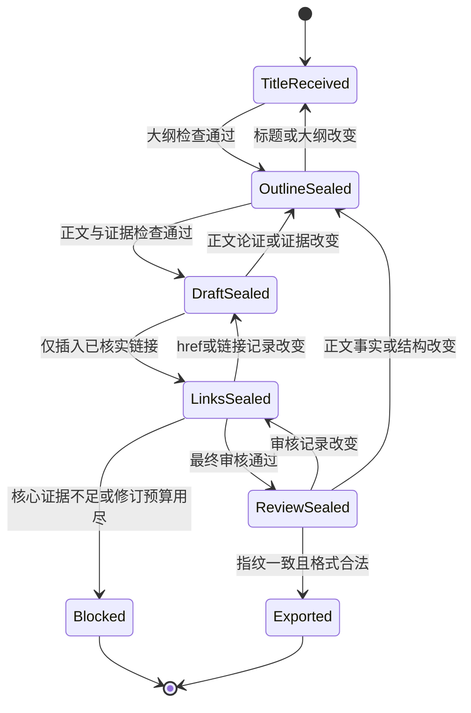

# 架构决策

## 模块职责与契约

| 模块 | 读入 | 负责写入 | 完成条件 |
|---|---|---|---|
| 总控 divoom-article-workflow | 标题、配置、各阶段状态 | run.json；最后articles.json | 所有阶段指纹有效，最终审核通过 |
| divoom-outline | 标题、选中类型FX规范、实际资料 | outline.json、初始evidence.json | 标题承诺、类型、H2问题链和证据需求明确 |
| divoom-draft | 已封存大纲、证据、正文与产品规则 | body.html、metadata.json、完善evidence.json | 正文事实/结构/类型成立、关键主张有依据 |
| divoom-links | 已封存正文、锚文本规则和目标页面 | 同一body.html中的锚、links.json | 实际链接与记录一致，目标内容已核对 |
| 总控最终审核 | 最终正文、meta、证据、链接 | review.json、审核封存 | 七维及事实覆盖满足门槛，零硬伤 |
| 确定性导出器 | 有效run与唯一正文及图片计划 | 非空博客JSON数组；独立image-prompts.txt | 字段准确、不带发布状态；配图与同一封存稿匹配 |

## 失效与返工图

状态图表示必须回到哪一层重新核验，不会自动替用户执行旧输出的撤回或上线。当前导出是快照；后续文件有变不能拿旧审核导出新稿。

## 对用户的单一接口

输入标题，输出一份非空博客数组。不会因为内部复杂而要求用户填多张表。模型推断类型、FX、品类和栏目；只有影响承诺的真实歧义才询问。入口的输出合约与推理流程分离，未来发布器变化只修改适配契约，不重写正文规范。

## 组合式阶段能力

四个可发现Skill：总控、规划、正文、链接。总控管理顺序与返工；阶段按共享契约读取同一run，模块可以单独续跑某个阶段，但不能无前序凭空跳阶段。它们是串行角色能力，不是多模型并发调度。复杂度来自内容规则，不能通过删规则换短入口；细节采用按需加载。

## 依赖图与唯一真源

输入 → outline → draft → links → review → export。正文只在body.html中，metadata只在metadata.json中。大纲、证据、链接、审核各有属主。最终JSON是确定性输出，不由模型再次复制全文。标题、博客、标签在大纲与meta中有一致性检查。

image-prompts 导出属于同一 export 阶段，读取有效 review 的 visual_plan 与固定图像会话主提示词；不复制第二份正文，不新增模型或生图服务。图位的 reference_mode/reference_requirement 与英文 prompt 绑定到 outline 指纹，修改参考策略会使下游失效。产品图由后续图像会话索要与使用；这不阻断标题到文章的执行，也不把参考照片当成内部结构证据。

各封存指纹含配置。draft绑定去除锚标签但保留正文/其他结构的语义投影，允许links阶段仅包装已有文字；任何换词/新增段落使draft失效。links和review绑定完整HTML，换一个href也会让下游失效。review变化同样需重新封存；旧输出只是过去的快照，不能证明新稿通过。

配置 `html_comments_v1` 时，outline 拥有图位与自包含英文 prompt，draft 将 pending 图位写成受约束的 `DIVOOM_IMAGE_PROMPT_V1` HTML 注释。注释进入内容指纹，但不计入读者可见文本或词数；它们必须与大纲一一匹配且处于计划章节。生成、上传素材和替换真实图片不属于本流程；替换后应更新图位状态并重审。输出仍是同一份 `html代码`，不增加发布器未知的顶层字段。

当前部署另用 `visible_alt_v1` 在 prompt 前写可见 images_N：alt 编号段，绑定图片计划，方便后台定位换图；它们不算编辑正文或证据。通用 Banner 由 Liquid 固定输出，不从正文取图；因此第一张正文场景图完整保留，正文生成阶段也不再生成 Banner 提示词。

## 质量与机械门禁分离

Technology 编辑协议 2 在 outline 绑定同 FX 实际样本，并记录逐节职责、改变/保持的条件、可观察信号、FAQ 决定和图位。draft 只采用 ready 素材；review 逐项核查段落推进和图文一致性。outline 的这些字段沿用现有封存链，所以修改图位或场景会使旧审核失效；不增设生图服务或新的编排阶段。新 run 执行新契约，历史 run 可继续读取，不自动声称符合新审核。

脚本确保格式、依赖和审查记录存在；模型确保记录诚实、证据适用、论证完整。词库、HTTP200、自评分都不是事实真值。每个关键主张必须有正文定位与来源范围，人工语义复核负责查漏。七维保持原门槛和风险封顶，不用代码关键词代替上下文。

## 最小运行依赖

Python标准库，无模型SDK、网络守护进程、数据库、Redis或Node构建步骤。可选Node脚本只为对照现有TS解析器。原始资料固定SHA并带SHA256 manifest；既可追溯又能离线查阅，时效性另行核实。只有快照，不复制旧稿/看板/凭据。

## 出口与权限

内容包不具备发布能力、凭据或计划任务。不输出发布字段，隐藏和排期属于现有发布器。页面Schema不是本次产品需求，不实现。用户拿到JSON后再交程序处理；包自己的测试不能触发Shopify写入。

## 失败策略

缺前序、指纹过期、关键事实不足、低分或格式不合法则停止导出。最多首稿加一次内容定向修订；不无限重试、不为交付假造结论。非关键内链可登记pending，不阻止正文；不适配的模板或部署栏目单列兼容限制。
