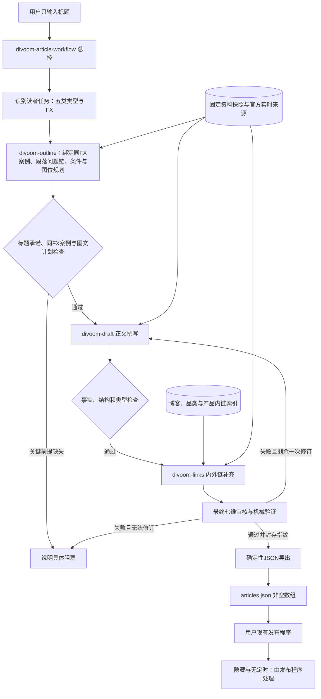
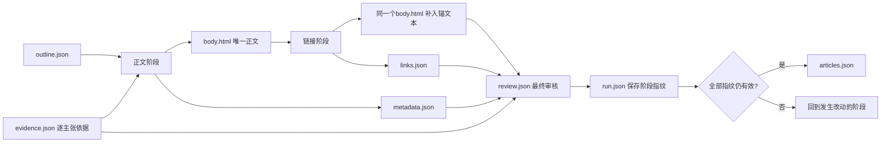

# Divoom Writing Skills Package

本部署已增加 [插图 prompt 随稿](skills/divoom-article-workflow/references/image-prompt-handoff.md)：仍只输出一份文章 JSON。通用 Banner 固定在 Liquid，正文只保留正文图位；待配图位置写可见的 images_1：alt 编号段及隐藏 prompt。可把原 JSON 或单个英文 prompt 交给图像会话，生成后上传媒体并用真实图片替换对应编号段和注释。本包不自动生图、上传或发布；不是对 Shopify 所有编辑路径保留注释的保证。

给一个标题，得到一个可以交给既有发布程序的博客数组 JSON。默认英文，五类内容自动判断，网站归属为 Technology Hub、Recommend & Comparison、Support & Tips。隐藏及排期由发布程序负责；本包没有发布能力。

## 架构与流程图



用户只接触标题和最终JSON；大纲、正文、证据、链接和审核记录是内部工作产物。上图来源研究从大纲开始，最后阶段插入的是已核实链接，不是文章写完才寻找证据。常规执行不需要逐阶段批准。



四个Skill按共享契约串行协作，不需要多Agent服务；详细模块职责、指纹规则和返工条件见 [架构设计](ARCHITECTURE.md)。

2026-10-17 更新：Technology Hub 新稿采用编辑协议 2，写之前规划条件、场景、列表/表格和配图；对应案例核验见 [案例索引](skills/divoom-article-workflow/references/technology-cases.json)，规则见 [编辑与配图规划](skills/divoom-article-workflow/references/editorial-planning.md)。F1–F13 已读，F14 另有补充候选且不冒充原始确认样本。此次只规划素材，不自动生图或上传。对用户仍只输出文章数组 JSON。

逐类配图、位置、段落条件和参考项目的完整报告：[Technology 图文审计](reports/technology-editorial-visual-audit-2026-10-17.html)。

## 安装与使用

将 `skills/` 下面四个目录一起复制到支持 SKILL.md 的助手技能目录，例如 Codex 的 `$CODEX_HOME/skills/`。不要只复制一个 SKILL.md；保留 references、config、scripts 和全部兄弟目录。不需要安装模型SDK、配置API key、运行看板或后端服务。脚本只需 Python 3.10+ 标准库。

调用示例：

```text
使用 $divoom-article-workflow
标题：Why Pixel Art Displays Look Different Up Close and Across a Room
```

默认依次规划大纲、撰写、补链、复核、导出。用户最终只拿到 `articles.json`；中间记录在独立 run 目录，按需查看。不是输入标题后由 Python 自动调模型，执行 Skill 的 AI 负责研究与写作，脚本负责机械门禁。

可选输入类型、FX、指定资料/产品或文章模板。默认不要求这些字段。中文标题会转换为忠实英文标题；不能擅自改变主题。

## 协作与状态

总控读取共享契约并串行调用 divoom-outline → divoom-draft → divoom-links。子技能共享路径契约，不传递多份正文，也不要求多Agent。最终审核及导出由总控执行。`body.html` 是唯一正文，导出直接引用经过审核的字节；正文改动后旧审核不能继续导出。

详细架构见 [ARCHITECTURE.md](ARCHITECTURE.md)。输出字段和实际解析器限制见 [publisher.md](skills/divoom-article-workflow/references/publisher.md)。源规则的保留/改编见 [MIGRATION.md](MIGRATION.md)。包内技能能离线读取固定资料，但遇到关键时效事实或链接验证仍需可用浏览工具。

## 检查命令

在包根目录执行：

```text
python skills/divoom-article-workflow/scripts/validate_package.py
python -m unittest discover -s tests -v
python skills/divoom-article-workflow/scripts/workflow.py validate path/to/articles.json
```

最后一个只检查内容格式；从 run 导出还要求证据、链接、七维审核和指纹都通过。评分和证据需要执行者真实审读，脚本无法替代事实审查。

若要对照现有发布程序的真实前端解析器（不启动服务、不写程序目录、不发文章）：

```text
node tests/publisher-compat.cjs --publisher D:/divoom-publisher --json path/to/articles.json
```

兼容测试使用发布程序已有 TypeScript 依赖；不捆绑或修改发布程序。默认通用站点配置里的示例名称不是 Divoom 栏目。上传界面选择可自选 Blog 的栏目或已登记的目标；显式 blog 使用真实栏目名称。不要把格式通过当作部署映射也已核实。

实际验收记录见 [VALIDATION.md](VALIDATION.md)。没有声称完成未执行的五类模型端到端写作测试。
